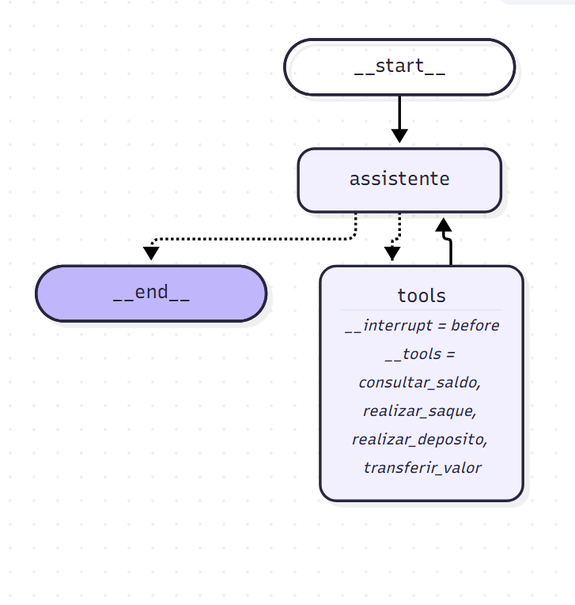
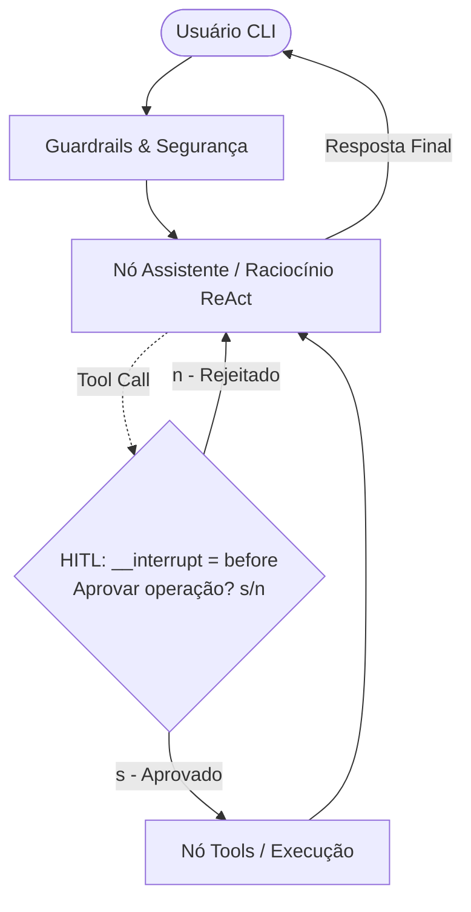

# 💳 Agente Bancário com LLM, ReAct, HITL e Ollama

<p align="center">
  
  
  
  
  
  
  
  
  
</p>

> **Desenvolvido por Marcelo Lampe Zacharias**  
> *Engenheiro de Software & Arquiteto de Sistemas (20+ anos de experiência) | Esp. em Inteligência Artificial Aplicada (UFPR) | Mestrando em Inteligência Computacional (UTFPR)*
---

## 🌟 Sobre o Projeto

Este projeto implementa um **Agente Bancário Inteligente de Linha de Comando (CLI)** totalmente integrado a modelos locais de Inteligência Artificial via **Ollama**. A arquitetura combina o padrão **ReAct (Reason and Act)** para tomadas de decisão dinâmicas com o mecanismo de **HITL (Human-in-the-Loop)** para validação humana de transações críticas, garantindo segurança, determinismo e observabilidade de ponta a ponta.

---

## 🧠 Arquitetura: ReAct + HITL + Guardrails

O sistema opera sob três pilares de engenharia de agentes autônomos:

1. **ReAct (Reason and Act):** O modelo LLM atua como o cérebro de raciocínio (`nó assistente`). Ele analisa a intenção do usuário, decide se precisa chamar uma ferramenta (*Tool Call* representada por `-.->`) ou se já pode responder diretamente, interpreta os retornos das ações executadas (`tools --> assistente`) e conclui a tarefa.
2. **HITL (Human-in-the-Loop):** Implementado por meio de interrupções explícitas dentro do fluxo de execução (`__interrupt = before` no nó `tools`), exigindo aprovação humana interativa (`s/n`) antes de efetivar qualquer operação financeira sensível.
3. **Guardrails de Segurança:** Camada intermediária de proteção que analisa a entrada do usuário em busca de linguagem imprópria, tentativas de injeção de prompt (*jailbreak*) e comportamentos fora de conformidade.

### Diagrama de Arquitetura





---

## 📂 Estrutura de Arquivos

| Arquivo / Módulo | Descrição Técnica |
| :--- | :--- |
| **`main.py`** | Ponto de entrada do sistema; integra o grafo de estados do agente à interface de linha de comando (CLI), gerenciando sessões, entradas do usuário e observabilidade. |
| **`graph.py`** | Define o grafo de estados do agente bancário, integrando o modelo LLM (Ollama), as ferramentas (*tools*), a lógica de fluxo e o ponto de interrupção HITL. |
| **`tools.py`** | Define as ferramentas executáveis pelo agente para interagir com o banco de dados (consultas de saldo, saques, depósitos e transferências). |
| **`database.py`** | Gerencia a persistência dos dados do banco em um arquivo JSON, controlando contas de usuários e saldos. |
| **`guardrails.py`** | Implementa o sistema de restrições de segurança (*guardrails*), filtrando linguagem imprópria, tentativas de *jailbreak* e comportamentos indesejados. |
| **`logger.py`** | Gerencia a observabilidade do sistema, registrando operações bancárias e eventos do agente em arquivos de log separados. |
| **`banco.json`** | Mock de banco de dados funcional para persistência e testes locais. |
| **`.log`** | Arquivos de saída para auditoria das operações e observabilidade do fluxo. |

---

## ⚙️ Instalação e Execução

O projeto padroniza o uso da ferramenta **`uv`** para gerenciamento ultrarrápido de pacotes, compilação determinística e isolamento de ambientes virtuais Python.

### 1. Inicializar o Projeto e Ambiente Virtual
```bash
# 1. Criar o diretório do projeto e entrar nele
uv init agent_banco
cd agent_banco

# 2. Criar o ambiente virtual já usando o Python 3.11 (localiza ou baixa automaticamente)
uv venv --python 3.11

# 3. Ativar o ambiente virtual no Windows (PowerShell)
.venv\Scripts\Activate
```

### 2. Instalar Dependências e Sincronizar
```bash
# 4. Instalar as dependências principais
uv pip install langchain langchain-core langchain-community langchain-ollama langgraph pydantic

# 5. Criar e sincronizar arquivos de dependências
uv sync
```

### 3. Executar a Aplicação
```bash
python main.py
```

---

## 🕹️ Comandos de Interação CLI

Durante a execução no terminal, utilize os seguintes comandos para controlar a sessão:

* **`/sair`** — Encerra a aplicação de forma segura.
* **`/usuario`** — Alterna o usuário ativo na sessão bancária.
* **HITL (`s` / `n`)** — Quando uma transação financeira for solicitada, o agente pausará a execução e aguardará sua confirmação explícita com **`s`** (aprovar) ou **`n`** (recusar).